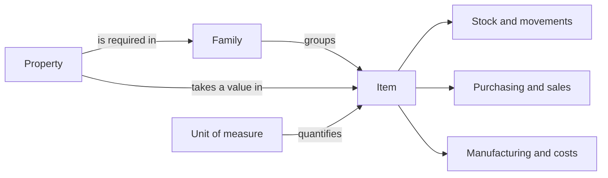

The catalog is the foundation of Bold. It defines what you purchase, manufacture, store, consume, sell and value.

## Concepts in this group

<Columns cols={2}>
  <Card title="Families" icon="package-open" href="/en/concepts/catalog/families">
    Groups of items that share properties or processes.
  </Card>
  <Card title="Items" icon="barcode" href="/en/concepts/catalog/items">
    Operational units for stock, purchasing, sales, manufacturing and costs.
  </Card>
  <Card title="Family vs item" icon="git-compare" href="/en/concepts/catalog/family-vs-item">
    Criteria for separating families, variants and physical references.
  </Card>
  <Card title="Properties" icon="list-filter" href="/en/concepts/catalog/properties">
    Reusable attributes for variants, validation and conditions.
  </Card>
  <Card title="Units of measure" icon="ruler" href="/en/concepts/catalog/units-of-measure">
    Quantities used in stock, purchasing, sales, manufacturing and costs.
  </Card>
</Columns>

## How they fit together

| Concept | Use |
| --- | --- |
| Family | Commercial or technical grouping that brings together related items and defines their required properties. |
| Item | Unique physical element. Bold tracks its stock, purchasing, sales, manufacturing and costs. |
| Property | Reusable attribute that distinguishes variants, such as color, size, material or finish. |
| Property value | Specific value that describes a variant within a family. |
| Unit of measure | How stock, orders, consumption and production are quantified. |
| Co-product | Additional output generated during manufacturing. |

The family organizes variants. The item is the operational reference with its own stock, orders, manufacturing and costs. Properties explain the differences between items in the same family.

Read the pages in this group for the rules on required information, consolidation, units and variant modeling.

## Relationship with other areas

| Module | Dependency on the catalog |
| --- | --- |
| Planning | Uses items, lead times, reorder points and procurement sources. |
| Warehouse | Stock is recorded by item, location and optional lot. You manage lots in the warehouse when you need traceability. |
| Manufacturing | Recipes can link to families or items and produce or consume items. |
| Costs | Costs are calculated from items, lots, consumption, production and inventory value. |
| Integrations | Link the operational item to references in other systems. |

## Related guides

- [Group variants](/en/guides/catalog/group-items-into-families)
- [Create an item](/en/guides/catalog/create-an-item)
- [Edit an item](/en/guides/catalog/configure-an-item)
- [Properties](/en/concepts/catalog/properties)
- [Units of measure](/en/concepts/catalog/units-of-measure)
- [Lots](/en/concepts/warehouse/lots)
