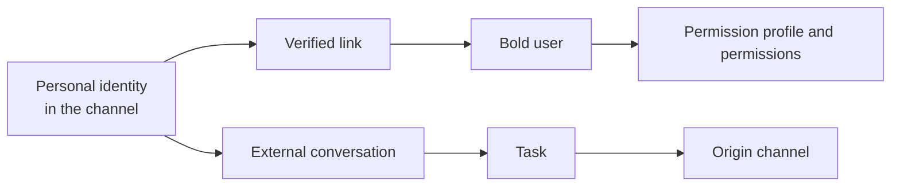

A **related identity** links a Bold user to their personal identity in a messaging channel. This relationship lets Bold recognize who starts a conversation outside the application and apply their user permissions.

## Model elements

| Element | What it represents |
| --- | --- |
| Channel | External medium used to converse with Bold, such as Telegram or WhatsApp. |
| Personal identity | Account that identifies the person within the channel. |
| Related identity | Verified link between the channel identity and a Bold user. |
| Bold user | Identity that provides the applicable profile and permissions. |
| Origin channel | Channel associated with a task started from an external conversation. |

Two channels are currently available:

| Channel | Availability | Conversation |
| --- | --- | --- |
| Telegram | When enabled for the company, through the company's bot. | Supports text, images, documents and audio. |
| WhatsApp | When it appears in **My account**, through the Bold Factory WhatsApp number, shared by all companies. | Supports only text for now. |

## Link and identity

The link belongs to a person. Verification uses a temporary link generated by Bold and establishes which user corresponds to the external identity.

| Status | Conceptual effect |
| --- | --- |
| Not linked | Bold does not associate the channel identity with a user. |
| Linked | The external identity is recognized as the associated user. |
| Unlinked | Chatting with Boldy is no longer available from that identity until a new link is established. |
| Rejected | The link is not completed because the identity is already linked to another user in the company or, in WhatsApp, in another company. |

Each user can have one linked identity per channel, and each external identity corresponds to a single user in the company. In addition, a WhatsApp identity can be linked in only one company at a time. To use it in another company, first unlink it in the company where it is linked.

<Warning>
  An external identity is personal. Sharing it between several users breaks the correspondence between the person conversing and the permissions applied.
</Warning>

## Relationship with permissions

The related identity does not grant its own permissions or expand the user's permissions. It only carries the already verified identity into the external channel.

| Question | Responsible concept |
| --- | --- |
| Who is conversing from the channel? | Related identity. |
| Which data can they query? | User permissions. |
| Which actions can they perform? | User permissions and element rules. |
| Where does the conversation continue? | Task's origin channel. |

## Tasks started from a channel

A task retains its origin channel. Its activity and result can be viewed from Bold, but clarifications and replies continue in the external conversation where it started.

### Illustrative example

Laura links her Telegram identity to her Bold user and starts a task from that channel.

- Bold recognizes Laura through the related identity.
- The task can only access what Laura's profile allows.
- Activity and results remain visible in Bold.
- Clarifications for that task remain in the Telegram conversation that originated it.

The channel changes where the conversation takes place, rather than the identity or access scope.

## Related

- [Link Telegram](/en/guides/control-panel/link-telegram-to-your-account)
- [Link WhatsApp](/en/guides/control-panel/link-whatsapp-to-your-account)
- [Tasks](/en/concepts/smart-factory/tasks)
- [Users, permission profiles and permissions](/en/concepts/control-panel/users-permission-profiles-and-permissions)
