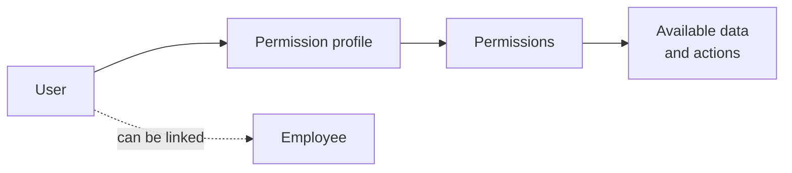

A **user** accesses Bold. A **permission profile** groups permissions. A **permission** enables a specific capability. Together, they form people's access model for the application.

## Entities

| Concept | What it represents | What it does not represent |
| --- | --- | --- |
| User | Identity with access credentials. | A person's work activity. |
| Permission profile | Reusable set of permissions. | A workstation or individual identity. |
| Permission | Specific capability to query, edit or perform an action. | A guarantee that the action is valid in every state. |
| Employee | Operational person who records work, even if they do not always have a user. | An account with access to Bold. |

<Info>
  A user and employee can be linked, but they are different concepts. The user answers “who enters and what can they do?”. The employee answers “who works, records time or contributes to costs?”.
</Info>

## Capability types

Permissions distinguish capabilities with different effects:

| Capability | What it allows |
| --- | --- |
| Query | View data. |
| Editing | Create or modify records and, depending on the module, complete or cancel them. |
| Execution | Perform specific operational actions, such as working on the shop floor, sequencing orders or activating versions. |

A permission defines access but does not remove data rules. For example, a document's status can prevent an action even if the user has the corresponding permission.

## Permission profiles by responsibility

Profiles represent reusable responsibilities. They do not need to mirror every person in the company.

| Typical profile | Common scope |
| --- | --- |
| Administration | Settings, users and master data. |
| Warehouse | Stock, receipts, movements and stock counts. |
| Production | Orders, operations, consumption and progress. |
| Maintenance | Assets, preventive maintenance and work orders. |
| Read only | Reading without operational changes. |

<Warning>
  Write permissions can change stock, costs or traceability. Temporary or external profiles should not include capabilities outside their responsibility.
</Warning>

## Permissions by module

| Module | Common data and actions |
| --- | --- |
| Common access | Access to Bold, administrative mode and work mode. |
| Catalog | Families, properties and items. |
| Warehouse | Locations, receipts, shipments, stock counts, movements and packages. |
| Planning | Customers, suppliers, orders, recommendations and items eligible for planning. |
| Production | Recipes, orders, requests, workstations and sequencing. |
| Maintenance | Assets, causes, actions, work orders and preventive maintenance. |
| People | Users, employees, work days, calendars, shifts and tasks. |
| Files and labels | Attachments, evidence, designs and templates. |
| Smart Factory | Reports, Boldy, tasks and automations. |

Some capabilities combine more than one module. For example, uploading evidence may require file access as well as permission for the functional element.

Managing users, profiles and permissions requires an application administration profile. It is not an operational People permission.

## Illustrative example

Marta can be both a user and an employee:

| Dimension | Example |
| --- | --- |
| User | Signs in to Bold with her credentials. |
| Profile | Has the **Production manager** profile. |
| Permissions | Can view and update manufacturing orders. |
| Employee | Records time in operations and contributes to cost calculation. |

If she only needed to record work through an operational identity, she could exist as an employee without a user with administrative access.

## Access for integrations and automations

| Identity | Access model |
| --- | --- |
| User | Receives permissions through a profile. |
| Integration key | Does not use profiles or support configurable scopes. It currently has broad administrative access to the tenant. |
| Automation | Acts with delegated permissions to complete its work. |

These identities are not interchangeable. See [Integration keys and external notifications](/en/concepts/control-panel/integration-keys-and-external-notifications) to learn about the scope of technical credentials.

## Related

- [Control panel](/en/concepts/control-panel)
- [Employees](/en/concepts/people/employees)
- [Integration keys and external notifications](/en/concepts/control-panel/integration-keys-and-external-notifications)
- [Automations](/en/concepts/smart-factory/automations)
- [Invite users](/en/guides/users-and-permissions/invite-users)
