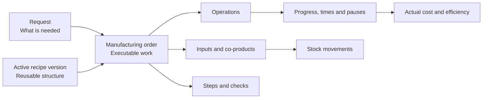

A **manufacturing order** is actual work that you can plan, execute, pause, complete or cancel.

The order originates from a manufacturing request. It can copy a recipe's structure or be created without a recipe.

## Relationship map

## Request vs order

| Concept | Role |
| --- | --- |
| Manufacturing request | Requirement to manufacture a quantity before a date. |
| Manufacturing order | Executable work with operations, inputs, steps and checks. |
| Operation | Specific stage within the order. |
| Progress | Completed, rejected or pending quantity. |

The request answers "what is needed". The order answers "how and when it is executed". Read [Manufacturing requests](/en/concepts/manufacturing/manufacturing-requests) for statuses, sources and assignment rules.

<Tip>
  Do not confuse the order with the recipe. The recipe is a reusable definition; the order contains specific work and retains its own execution records.
</Tip>

## With or without a recipe

| Release method | Result |
| --- | --- |
| With a recipe | The order copies applicable operations, inputs, co-products, steps, checks, restrictions and conditions from the active version. |
| Without a recipe | The order starts without operations or a structure copied from a recipe. |

An order without a recipe can represent exceptional work or work that is not yet standardized. It is not ready for execution until it has operations and sufficient planning.

## What an order with a recipe copies

| From the recipe | In the order |
| --- | --- |
| Operations | Executable operations. |
| Inputs | Expected materials. |
| Co-products | Expected additional outputs. |
| Steps | Work instructions. |
| Checks | Mandatory inspections at the configured moment. |
| Restrictions | Precedence between operations. |
| Conditions | Elements applicable to the manufactured variant. |

On order inputs and co-products, you can change the quantity and the consumption or production moment, but not the item. To use another item, delete the input or co-product and add a new one. This way, material planning, stock reservations and planned cost are linked to the correct item.

## Status and traceability

The order's status is derived from its operations. If operations start, pause or finish, the order reflects that progress.

The planned quantity should change only before starting. Afterward, the history of progress, consumption and production protects traceability.

| Status | When it appears |
| --- | --- |
| **Pending planning** | The order exists but is not yet ready for execution. |
| **Planned** | Operations have enough planning to start when appropriate. |
| **In progress** | An operation has started. |
| **Paused** | Work is temporarily stopped. |
| **Blocked** | The order cannot progress until a pending condition is resolved. |
| **Finished** | Work has ended. |
| **Cancelled** | The order should no longer be executed. |

Read [Manufacturing statuses](/en/concepts/manufacturing/manufacturing-statuses) to compare order, operation, group and plan statuses.

### Reading example

A request for 100 units can be covered by two orders of 60 and 40 units. Each order retains its own structure, status and progress, while the request expresses the total requirement they both cover.

## Relationship with the warehouse and costs

| Order record | Related effect |
| --- | --- |
| Input consumption | Reduces stock of consumed materials. |
| Production | Increases stock of the manufactured item or co-products. |
| Actual times, consumption and quantities | Feed cost and efficiency calculations. |

If execution records are missing, actual cost will be incomplete.

## Related

- [Manufacturing requests](/en/concepts/manufacturing/manufacturing-requests)
- [Recipes and versions](/en/concepts/manufacturing/recipes-and-versions)
- [Manufacturing statuses](/en/concepts/manufacturing/manufacturing-statuses)
- [Assignments and operation groups](/en/concepts/manufacturing/assignments-and-operation-groups)
- [Inspections and checks](/en/concepts/manufacturing/inspections-and-checks)
- [Checks, consumption and pauses](/en/concepts/manufacturing/checks-consumption-and-pauses)
- [Create an MO without a sales order](/en/guides/manufacturing/create-an-mo-without-a-sales-order)
- [Execute operations on the shop floor](/en/guides/manufacturing/execute-shop-floor-operations)
