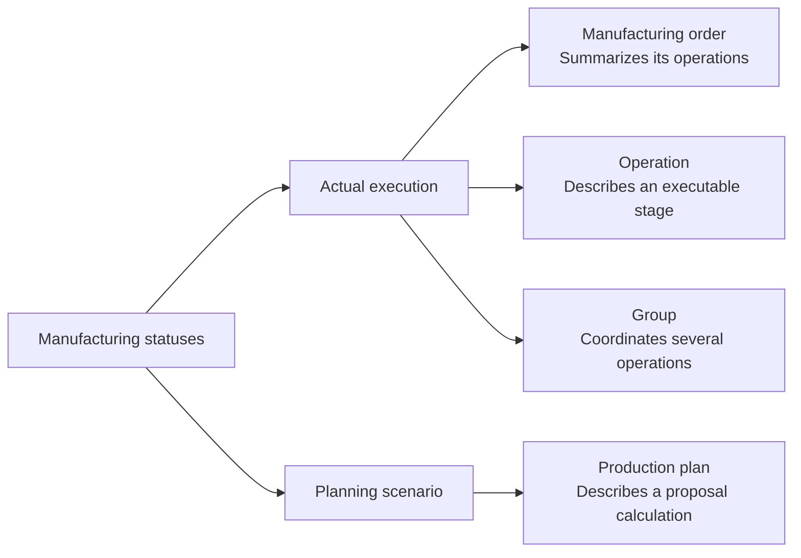

Manufacturing statuses indicate whether work is pending, ready, executing, stopped, finished or canceled.

Read the status alongside its object. An order, operation, group and plan do not change through the same actions.

## Two types of status

| Object | What its status expresses | What it does not imply |
| --- | --- | --- |
| Manufacturing order | Overall situation of executable work. | That all its operations have the same status. |
| Operation | Situation of a specific stage. | That the entire order has reached that status. |
| Operation group | Situation of the operational block. | That the individual history of its operations disappears. |
| Production plan | Situation of a proposal's calculation. | That actual operations have changed. |

<Tip>
  The same term does not always describe the same reality. **Planned** on an order or operation belongs to execution; **Solution found** on a plan belongs to the planning scenario.
</Tip>

## Manufacturing orders

An order summarizes the progress of executable work.

| Status | Meaning |
| --- | --- |
| **Pending planning** | The order exists but does not yet have sufficient planning for execution. |
| **Planned** | The order has operations ready for work. |
| **In progress** | An operation has started. |
| **Paused** | Work is temporarily stopped. |
| **Blocked** | The order cannot progress until a pending condition is resolved. |
| **Finished** | Work has ended, preserving traceability of progress, consumption and production. |
| **Cancelled** | The order should no longer be executed. |

The order's status is derived from its operations and the rules protecting actual execution.

For example, an order can be **In progress** while one operation is already **Finished**, another remains **In progress** and the rest remain **Planned**.

## Operations

An operation is the executable unit within an order.

| Status | Meaning |
| --- | --- |
| **Pending planning** | Required planning or assignment is missing. |
| **Planned** | It can be prepared for execution. |
| **In progress** | Work has started and can record progress, consumption or checks. |
| **Paused** | The operation is stopped by an interruption. |
| **Finished** | The operation has ended. |
| **Cancelled** | The operation is no longer part of executable work. |

Restrictions between operations can prevent starting an operation even when it is planned.

## Operation groups

A group lets you execute several operations as an operational block.

| Status | Meaning |
| --- | --- |
| **Planned** | The group exists and can be prepared for execution. |
| **In progress** | The group has started. |
| **Paused** | The group is temporarily stopped. |
| **Finished** | The group has ended, and each operation retains its history. |

The group status does not replace each operation's status. Use it to operate them together.

## Production plans

A production plan is a scenario. Its status describes the proposal's calculation, not actual execution.

| Status | Meaning |
| --- | --- |
| **Pending** | The plan is created or updated but is not being solved yet. |
| **Processing** | Bold is calculating a sequencing proposal. |
| **Solution found** | A proposal exists that you can review and apply. |
| **Error while searching for a solution** | The calculation did not finish correctly. |
| **No feasible solution** | No valid sequence was found with the current data and restrictions. |

A solution belongs to the plan until applied. A plan with **Solution found** can therefore coexist with actual operations that still retain their earlier dates and resources.

## Related

- [Manufacturing orders](/en/concepts/manufacturing/manufacturing-orders)
- [Operations and restrictions](/en/concepts/manufacturing/operations-and-restrictions)
- [Assignments and operation groups](/en/concepts/manufacturing/assignments-and-operation-groups)
- [Production plans](/en/concepts/manufacturing/production-plans)
- [Pause reasons and interruptions](/en/concepts/manufacturing/pause-reasons-and-interruptions)
