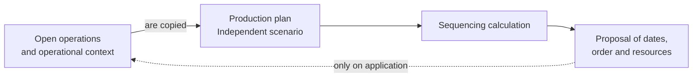

A **production plan** is a planning scenario. It copies open operations, resources, restrictions, manufacturing working hours, dates and stock context to calculate a sequencing proposal.

The plan does not change actual execution until you apply it.

## Conceptual model

| Concept | What it represents | Effect on actual execution |
| --- | --- | --- |
| Sequencing | Calculation that orders operations. | None on its own. |
| Production plan | Scenario that copies open work and its context. | None while the proposal remains in the plan. |
| Proposal | Result calculated within the plan. | None until applied. |
| Application | Transfer of the proposal to open operations. | Updates the planning of those operations. |

## What they are for

| Use | Result |
| --- | --- |
| Evaluate capacity | See whether work fits available resources and working time slots. |
| Compare alternatives | Try dates and resource selections before deciding. |
| Detect blocks | Find operations without a resource, material or feasible sequence. |
| Apply a proposal | Update actual operations when the plan is executable. |

## Creation and updates

When you create a plan, Bold loads all active operations and orders, stations, tools and manufacturing working hours. The horizon starts at the current moment, or at the earliest planned start if earlier, and spans one year. You do not choose a subset of orders, dates or resources during creation.

| Option | Effect |
| --- | --- |
| Restrict by raw materials | Includes material availability as a calculation restriction. |
| Consider employees as a limiting factor | Adds employees as solver resources. Does not assign them to actual operations. |
| Create only | Creates and updates the scenario without solving it. |
| Create and solve | Creates the scenario and starts the calculation. |
| Create, solve and apply | Creates, solves and automatically applies the solution found. |

The two solving options let you choose the **Solving mode** when creating the plan. The application initially selects **Basic (fast)**.

Updating the plan copies current operational reality again. Later changes to orders, resources, working hours or materials do not appear until you update it again.

## Solve and apply

Solving calculates a proposal. You can also request automatic application if the calculation finds a solution.

| Mode | How it calculates the proposal |
| --- | --- |
| **Basic (fast)** | Quickly searches for a feasible sequence using a heuristic. If it cannot complete the sequence, the plan becomes **Error while searching for a solution**. |
| **Advanced (optimized)** | Uses the heuristic sequence as a starting point and refines it with mathematical optimization to improve the result. Can take several minutes. |

The **Solve** dialog initially selects **Basic (fast)**. If you integrate through the API and omit `mode` when creating and solving a plan or calling the solve operation, the server uses **Advanced (optimized)**.

When applied, Bold updates the target date of included open operations. For **Pending** or **Planned** operations, it also updates the selected station and tool. It does not create employee assignments or modify finished or canceled operations.

## Calculation statuses

| Status | Meaning |
| --- | --- |
| **Pending** | The plan is created or updated but is not being solved yet. |
| **Processing** | Bold is calculating a sequencing proposal. |
| **Solution found** | A proposal exists that you can review and apply. |
| **Error while searching for a solution** | The calculation did not finish correctly. In basic mode, it also indicates that the heuristic could not complete the sequence. |
| **No feasible solution** | No valid sequence was found with current data and restrictions. |

Read [Manufacturing statuses](/en/concepts/manufacturing/manufacturing-statuses) to distinguish plan statuses from actual execution statuses.

<Tip>
  **Solution found** describes the calculation result. It does not mean actual operations are **Planned** with those dates and resources.
</Tip>

## What it does not modify

A plan does not change finished or canceled operations or replace actual execution records. It works on the copy of open work available when it was created or updated.

## Relationship with planning

Planning answers what is missing and when. The production plan answers how to fit manufacturing work into available resources and time slots.

## Related

- [Sequencing](/en/concepts/manufacturing/sequencing)
- [Manufacturing statuses](/en/concepts/manufacturing/manufacturing-statuses)
- [Manufacturing working hours](/en/concepts/manufacturing/manufacturing-working-hours)
- [Resources](/en/concepts/manufacturing/resources)
- [Know what to manufacture](/en/guides/planning/decide-what-to-manufacture)
- [Sequence orders](/en/guides/manufacturing/sequence-orders)
