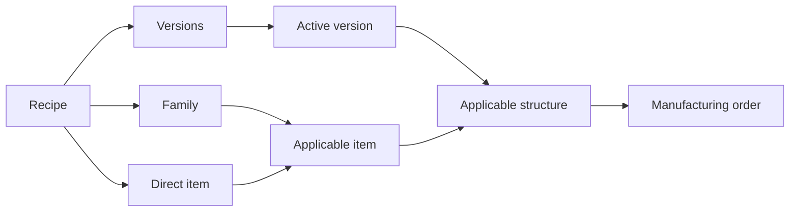

A **recipe** describes how to manufacture one or more items. It defines operations, inputs, co-products, steps, checks, restrictions and conditions.

A recipe does not execute work. It provides a template to create manufacturing orders with a controlled structure.

## Relationship map



| Concept | What it represents | Relationship with execution |
| --- | --- | --- |
| Recipe | Definition of how to manufacture one or more items. | Does not execute work. |
| Version | Recipe structure at a specific time. | The active version is the basis for new orders. |
| Applicability | Relationship between a recipe and a family or item. | Determines which items the recipe can be evaluated for. |
| Manufacturing order | Executable work. | Copies applicable elements from the active version. |

## What a recipe contains

| Element | Use |
| --- | --- |
| Applicability | Families and items it can apply to. |
| Version | Approved or editable recipe structure. |
| Operations | Executable process stages. |
| Inputs | Materials or semi-finished items consumed. |
| Co-products | Additional outputs generated. |
| Steps | Instructions for operators. |
| Checks | Mandatory quality or process checks. |
| Restrictions | Precedence between operations. |
| Conditions | Rules applied according to item properties. |

## Applicability to families and items

You can link a recipe in two ways:

| Link | Behavior |
| --- | --- |
| Family | The recipe is evaluated for items in that family. You can add a condition based on their properties. |
| Direct item | The recipe is evaluated for that item even if it does not reach it through its family. This link does not depend on the family condition. |

If an item does not meet the family condition and has no direct link, the recipe is not considered applicable. If a property needed to evaluate the condition is missing, the recipe appears as **Missing information**.

An item can have several applicable recipes. Bold orders them by priority and uses the first **Ready** recipe as the primary recipe. Priority distinguishes the preferred recipe from alternatives.

## Status for an item

The status is calculated for each item-recipe combination.

| Status | Meaning |
| --- | --- |
| **Ready** | The recipe has an active version, and the item provides all necessary properties. |
| **Missing information** | The recipe can apply, but properties needed to evaluate conditions or formulas are missing. |
| **Inactive** | The recipe is linked to the item but has no active version. |

Bold identifies missing properties. While they are missing, the recipe is not **Ready** for that item.

## Versions

A version preserves a manufacturing structure at a specific time. Only one version should be active for new orders.

| Status | Meaning |
| --- | --- |
| Editable | Allows structural changes. |
| Active | Used for new orders and protects traceability. |
| Inactive | Retained as history or reference. |

The **Active** version represents the approved structure for new orders. **Inactive** versions preserve earlier structures as history or reference.

## Conditions and variants

Conditions allow the same recipe to adapt to different items in a family.

| Condition | Determines |
| --- | --- |
| Family | Whether the recipe applies to an item in the linked family. |
| Operation | Whether a stage should exist. |
| Input | Whether a material is consumed. |
| Step | Whether an instruction is shown. |

Example: a table recipe can add a painting operation only when the **Finish** property requires it.

Conditions can use only properties that affect the manufactured item and are assigned to the corresponding family.

<Tip>
  A condition determines **whether** an element belongs to the structure. A formula calculates **what value** a quantity, measurement or instruction will have.
</Tip>

## Formulas

Formulas calculate input and co-product quantities, step durations and values shown in their instructions.

A formula can combine:

- numbers, using a period as the decimal separator, such as `0.15`;
- numeric properties of the manufactured item, such as **Length**;
- the **Production order quantity**;
- addition, subtraction, multiplication, division and parentheses;
- the rounding functions `round`, `ceil` and `floor`.

| Function | Result | Example |
| --- | --- | --- |
| `round(value, multiple)` | Rounds to the nearest multiple. Halfway values are rounded away from zero. | `round(Length * 0.35, 0.01)` leaves two decimal places. |
| `ceil(value, multiple)` | Rounds up to the next multiple. | `ceil(Production order quantity * 1.05, 12)` calculates full boxes of 12. |
| `floor(value, multiple)` | Rounds down to the previous multiple. | `floor(Length / 250)` counts whole pieces of 250 mm. |

The multiple is optional, defaults to `1` and must be greater than zero. It can be a number, a property or a formula.

In the editor, type `@` or use the **Property** and **Order data** buttons to insert values, and **Round** to add a function. Press `Ctrl+Z` to undo any change. This page's examples show formulas as they appear in the editor, with the name of each inserted property or data field.

In instructions, each formula block is replaced by its result:

```text
Cut material to [Length]+7 mm
```

If the manufactured item has `Length = 100`, the order will show `Cut material to 107 mm`.

<Note>
  Bold does not let you save a formula with a fixed multiple that is not greater than zero. If a property's value is missing, or a multiple depending on a property is not greater than zero, Bold cannot calculate the formula when creating the MO: the recipe calculation fails, and instructions show the unevaluated formula.
</Note>

## Editing and traceability

An active version is protected to preserve traceability. Structural changes belong to a different editable version; the active version continues to represent the approved structure used to create new orders.

## Related

- [Operations and restrictions](/en/concepts/manufacturing/operations-and-restrictions)
- [Inspections and checks](/en/concepts/manufacturing/inspections-and-checks)
- [Tools and characteristics](/en/concepts/manufacturing/tools-and-characteristics)
- [Processes](/en/concepts/manufacturing/processes)
- [Manufacturing requests](/en/concepts/manufacturing/manufacturing-requests)
- [Family vs item](/en/concepts/catalog/family-vs-item)
- [Create a recipe](/en/guides/manufacturing/design-the-manufacturing-steps)
