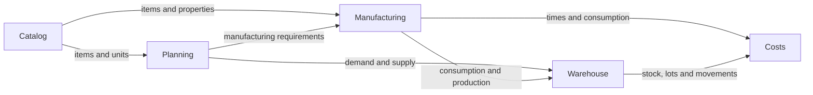

Use this section when you need to understand what data represents, which rules Bold applies or how modules relate to each other.

For step-by-step processes, go to **Guides**.

## Bold areas

<Columns cols={2}>
  <Card title="Catalog" icon="boxes" href="/en/concepts/catalog">
    Families, items, properties and variants.
  </Card>
  <Card title="Manufacturing" icon="factory" href="/en/concepts/manufacturing">
    Recipes, requests, orders, processes, resources, checks, assignments and execution.
  </Card>
  <Card title="Planning" icon="calendar-range" href="/en/concepts/planning">
    Demand, supply, projected stock, forecasts, purchasing, sales and recommendations.
  </Card>
  <Card title="Warehouse" icon="warehouse" href="/en/concepts/warehouse">
    Stock, load orders, warehouse movements, locations, packages, receipts and stock counts.
  </Card>
  <Card title="Maintenance" icon="wrench" href="/en/concepts/maintenance">
    Assets, causes, actions, preventive schedules and work orders.
  </Card>
  <Card title="Personnel" icon="users" href="/en/concepts/people">
    Employees, working days, calendars, shifts, planned availability and operational capacity.
  </Card>
  <Card title="Work mode" icon="tablet-smartphone" href="/en/concepts/work-mode">
    Operational interface for manufacturing, warehouse, maintenance, scanning and shop floor tasks.
  </Card>
  <Card title="Costs" icon="circle-dollar-sign" href="/en/concepts/costs">
    Theoretical cost, actual cost and inventory valuation.
  </Card>
  <Card title="Smart Factory" icon="sparkles" href="/en/concepts/smart-factory">
    Dashboards, reports, Boldy, tasks and automations.
  </Card>
  <Card title="Control panel" icon="settings" href="/en/concepts/control-panel">
    Account, company, users, permissions, integration keys, audit trail, events, data and designs.
  </Card>
</Columns>

## How the areas relate

Areas share entities and records. The catalog provides common references. Planning interprets requirements and expected receipts. Manufacturing and warehouse record operational reality, which then feeds costs and analysis.

**Personnel**, **Maintenance**, **Smart Factory**, **Work mode** and **Control panel** span multiple areas. They provide people, assets, execution, analysis and configuration to the concepts in the map.

## How it is organized

| Page type | Use it to |
| --- | --- |
| Area page | Understand the overall map of a module. |
| Concept page | Determine what an entity represents and when to use it. |
| Statuses and rules | Look them up within the area where they apply. |
| Guides | Execute workflows such as creating, receiving, moving, completing or configuring. |

## Where to find statuses and rules

Statuses, validations and traceability rules appear within each area. For example, warehouse explains when a receipt becomes protected, planning explains when a line generates demand or supply, and manufacturing explains what blocks an active version or an order with activity.

<Info>
  In the interface, Bold uses **Item** for the operational object you purchase, manufacture, store, consume or sell.
</Info>
