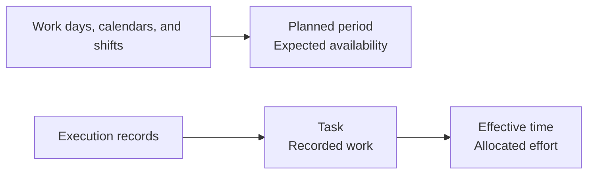

Bold distinguishes **planned availability** from **work performed**. Planned periods indicate when an employee is expected to work. Tasks capture intervals derived from actual execution.

## Key differences

| Concept | What it represents | What it does not prove |
| --- | --- | --- |
| Planned period | Dated interval when an employee is expected to work. | That the employee attended or worked. |
| Task | Execution interval related to production, maintenance, or warehouse work. | That the work was expected in their schedule. |
| Effective time | Part of a task allocated to the employee after accounting for possible overlaps. | Additional time when simultaneous tasks exist. |

<Info>
  A planned period describes expected availability. It is not an attendance record.
</Info>

## Origin of planned periods

Bold converts work days, calendars, and shifts into dated periods in the employee's time zone. When several rules apply to a date, the most specific one takes precedence.

| Priority | Source | What it represents |
| --- | --- | --- |
| 1 | Manual assignment | A direct exception for the employee and date. |
| 2 | Local calendar | A shared exception, such as a holiday or special work day. |
| 3 | Shift | The repeating work pattern. |

If no source provides a work day, there is no planned period for that day.

## Origin of tasks

Tasks are derived from execution records:

- assignments and time records for manufacturing operations;
- maintenance work order time records;
- load order execution;
- warehouse movements.

Each task retains the employee, work type, related item, and start and end times. A task does not represent a future assignment or replace employee planning.

## Simultaneous tasks

If several tasks overlap, Bold distributes effort over the shared interval. The same hour therefore does not count as a full hour in each task.

### Illustrative example

An employee has a planned period from **08:00 to 16:00**. They record an assembly task from **09:00 to 11:00** and an inspection task from **10:00 to 12:00**.

| Interval | Situation | Interpretation |
| --- | --- | --- |
| 08:00–09:00 | Planned period without a task | Expected availability with no recorded execution. |
| 09:00–10:00 | Assembly only | Effort is allocated to assembly. |
| 10:00–11:00 | Assembly and inspection | Effort is distributed between the two tasks. |
| 11:00–12:00 | Inspection only | Effort is allocated to inspection. |
| 12:00–16:00 | Planned period without a task | Expected availability with no recorded execution. |

The example lets you compare planning and execution, but does not prove attendance during intervals without tasks.

## What each data source answers

| Question | Source |
| --- | --- |
| When was the employee expected to work? | Planned periods. |
| What work was recorded, and when? | Tasks. |
| How much time is allocated after accounting for overlaps? | Effective task time. |

## Related

- [Employees](/en/concepts/people/employees)
- [Work days, calendars, and shifts](/en/concepts/people/work-days-calendars-and-shifts)
- [Assignments and operation groups](/en/concepts/manufacturing/assignments-and-operation-groups)
- [Maintenance work orders](/en/concepts/maintenance/work-orders)
