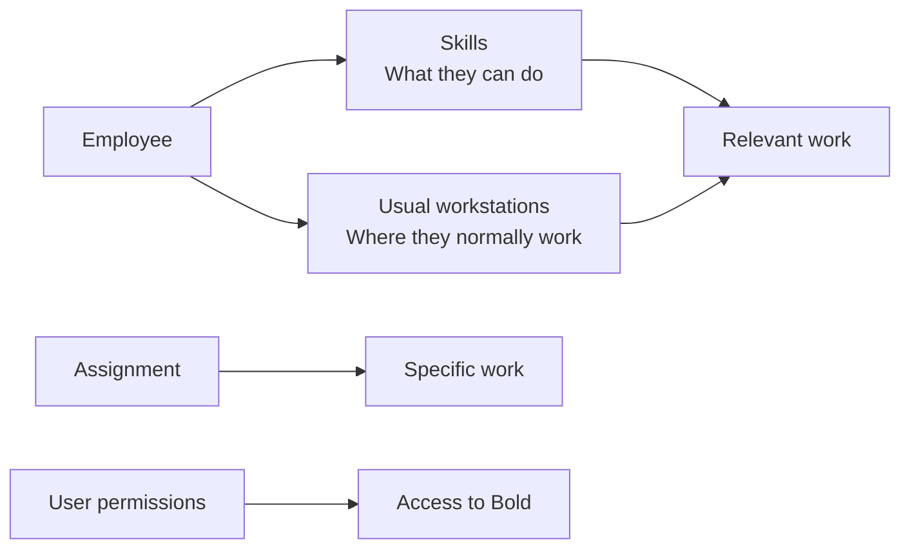

**Skills** and **usual workstations** describe what work an employee can usually do and where they normally work. They help determine which work is relevant to that person, but they do not assign it or confirm availability.

## Key differences

| Concept | Question it answers | Scope |
| --- | --- | --- |
| Skill | What kind of work can they do? | A process or operation type. |
| Usual workstation | Where do they normally work? | A workstation. |
| Assignment | Which specific work is prepared for them? | A particular operation or group. |
| Availability | When are they expected to work? | Periods calculated from schedules. |
| User permission | Which data and actions can they access? | Application modules and actions. |

<Info>
  Skills and usual workstations help identify relevant work. They do not replace an assignment, schedule, or access permissions.
</Info>

An employee can have skills without a user account. They can also have a user account without being configured for operational work.

## Skills

A skill is based on a [process](/en/concepts/manufacturing/processes). For example, an employee can be qualified for **Cutting**, **Assembly**, or **Final inspection**.

Skills relate employees to operations compatible with their capabilities. They also help you analyze which people can cover each kind of work.

A skill expresses operational capability. It does not guarantee that the employee is available or has an assigned operation.

## Usual workstations

A usual workstation indicates where a person normally works. It makes work at their workstation or cell relevant, without restricting their activity to that location.

The usual workstation and execution workstation are also different: the first expresses a stable preference; the second belongs to a specific operation.

## Illustrative example

Ana has the **Welding** skill and **Cell 2** as her usual workstation.

| Data | What you can infer |
| --- | --- |
| Welding skill | Welding process operations are compatible with her capabilities. |
| Cell 2 as usual workstation | Work in that cell is particularly relevant to Ana. |
| Assigned operation in Cell 4 | Ana has specific work outside her usual workstation. |
| Afternoon shift | Indicates when she is expected to be available. |
| Production permissions | Determine what she can view or change in Bold. |

These details complement each other. None lets you infer the others on its own.

## Relationship with work mode

[Work mode](/en/concepts/work-mode) can combine several signals to present relevant work:

| Signal | Contribution |
| --- | --- |
| Skills | Compatibility with the process. |
| Usual workstations | Affinity with the workstation or area. |
| Assigned operations | Direct relationship with specific work. |
| Operation groups | Membership of a shared block of work. |
| Active or recent operations | Continuity of work already started. |

<Tip>
  A level of detail consistent with the shop floor's actual organization helps skills and usual workstations distinguish relevant work.
</Tip>

## Related

- [Employees](/en/concepts/people/employees)
- [Work mode](/en/concepts/work-mode)
- [Processes](/en/concepts/manufacturing/processes)
- [Resources](/en/concepts/manufacturing/resources)
- [Assignments and operation groups](/en/concepts/manufacturing/assignments-and-operation-groups)
