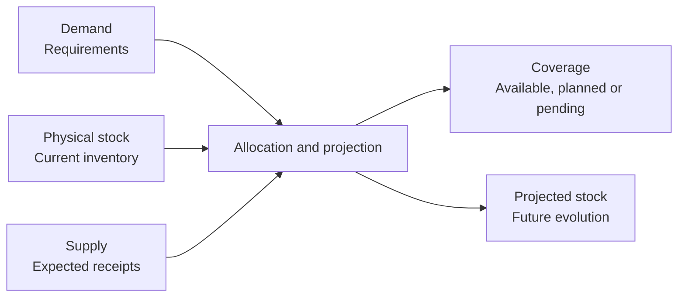

Planning compares **demand**, **supply** and **stock** to determine what is missing, when it is needed and how to cover it.

Demand indicates requirements. Supply indicates expected receipts. [Demand and supply allocation](/en/concepts/planning/demand-and-supply-allocation) explains what part of each requirement is covered by current stock or future receipts.

## How they relate



<Note>
  Do not confuse supply with physical stock. Supply represents an expected receipt; it only becomes stock when you receive the material or complete manufacturing.
</Note>

## Concepts

| Concept | Meaning |
| --- | --- |
| Demand | Stock requirement generated by a confirmed sale or expected manufacturing consumption. |
| Supply | Expected receipt from a confirmed purchase or manufacturing. |
| Allocation | Calculated relationship between a requirement and the stock or supply that covers it. |
| Projected stock | Future evolution after applying demand and supply. |
| To order | Direct coverage of a specific requirement. |
| To stock | Grouped coverage from common inventory and shared receipts. |
| Reorder point | Threshold from which replenishment is advisable. |
| Minimum order | Minimum recommended quantity. |
| Lot size | Operational multiple for rounding quantities. |

## Demand

Demand can come from confirmed sales orders, internal requirements or expected manufacturing consumption.

| Source | When it generates demand |
| --- | --- |
| Sales order | When the line is confirmed and a quantity remains to be delivered. |
| Manufacturing order or request | When it needs components or material for execution. |
| Expected consumption | When an open operation expects to consume material. |

A draft sales line does not generate demand. Only confirmed lines represent commitments included in planning.

## Supply

Supply can come from confirmed purchase orders, pending receipts, manufacturing requests or planned orders.

| Source | When it generates supply |
| --- | --- |
| Purchase order | When the line is confirmed and a quantity remains to be received. |
| Manufacturing request | When it represents a requirement to manufacture before a date. |
| Manufacturing order | When pending production should increase stock. |

When the warehouse receives material or production completes an order, pending supply becomes physical stock.

<Info>
  A forecast is a recommendation. It is not demand, supply or incoming stock, and it does not cover any requirement until you convert it into a purchase order or manufacturing request included in planning.
</Info>

## Projected stock

```text
Current available stock = physical stock - outgoing stock
Projected available stock = current available stock + incoming stock
```

Projected stock lets you detect shortages before physical stock becomes negative.

<Info>
  Physical stock describes what exists now. Projected stock includes future commitments and can anticipate a shortage while units are still in the warehouse.
</Info>

[Forecasts and assistants](/en/concepts/planning/forecasts-and-assistants) use this calculation to suggest purchases or manufacturing before you create documents.

## Coverage statuses

| Status | Meaning |
| --- | --- |
| **Already available** | There is enough stock now. |
| **Planned** | Future supply covers the requirement. |
| **Partially planned** | Only part is covered. |
| **Not planned** | You still need to create or confirm enough supply. |
| **No stock required** | The requirement does not need procurement. |

Read [Demand and supply allocation](/en/concepts/planning/demand-and-supply-allocation) to see how each status is determined.

## Example

You have 20 units of an item. There is a confirmed sale of 35 units and a confirmed purchase of 30 units that arrives before the delivery date.

| When | Element | Change | Projected stock |
| --- | --- | ---: | ---: |
| Today | Initial physical stock | 20 | 20 |
| Before delivery | Purchase supply | +30 | 50 |
| On the delivery date | Sales demand | -35 | 15 |

Although current physical stock is 20, the sale is covered if the purchase arrives on time. After covering the 35 units, projected stock is 15 units.

## Related

- [Planning](/en/concepts/planning)
- [Demand and supply allocation](/en/concepts/planning/demand-and-supply-allocation)
- [Forecasts and assistants](/en/concepts/planning/forecasts-and-assistants)
- [Stock and movements](/en/concepts/warehouse/stock-and-movements)
- [Know what to purchase](/en/guides/planning/decide-what-to-purchase)
- [Know what to manufacture](/en/guides/planning/decide-what-to-manufacture)
