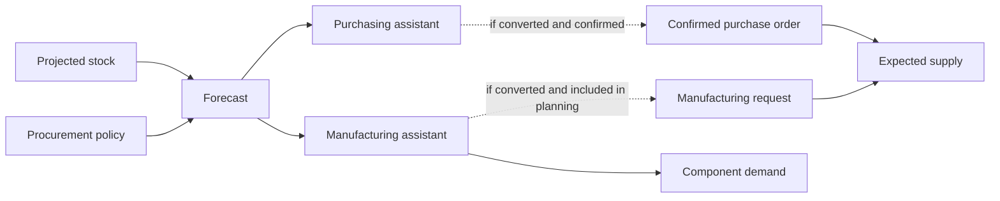

**Forecasts** are requirements suggested by Bold before you create operational documents. They help you determine what to purchase or manufacture, when to do it and in what quantity.

Assistants show these suggestions so you can review them before converting them into purchase orders or manufacturing requests.

<Note>
  Do not confuse a forecast with a commitment. The forecast proposes coverage; a confirmed document represents expected supply.
</Note>

## Forecast types

| Type | Expected result |
| --- | --- |
| Purchase forecast | Can be converted into a [purchase order](/en/concepts/planning/purchase-orders). |
| Manufacturing forecast | Can be converted into a [manufacturing request](/en/concepts/manufacturing/manufacturing-requests). |

A forecast does not change stock or count as supply of the forecast item. In a manufacturing forecast, Bold calculates the recipe's inputs and can generate component demand immediately. When you convert the forecast into a request or order, the manufactured product becomes part of expected supply.

## Relationship model

## What data Bold uses

Bold compares stock, demand, supply and the item's procurement policy.

| Data | Effect |
| --- | --- |
| Current stock | Physical starting point. |
| Outgoing stock | Sales or consumption commitments that reduce availability. |
| Incoming stock | Confirmed purchases and manufacturing that increase future availability. |
| Reorder point | Threshold that triggers a recommendation to stock. |
| Minimum order | Minimum suggested quantity when replenishing. |
| Lot size | Multiple used to round quantities. |
| Preferred supplier | Proposed source for purchasing. |
| Delivery or manufacturing lead time | Date from which procurement should be released. |

Read [Demand and supply](/en/concepts/planning/demand-and-supply) to understand how projected stock is calculated.

## Assistant comparison

| Aspect | Purchasing assistant | Manufacturing assistant |
| --- | --- | --- |
| Included items | Configured for procurement through purchasing. | Configured for procurement through manufacturing. |
| Main organization | Requirements grouped by supplier. | Requirements grouped by period. |
| Context shown | Quantities worth purchasing and proposed supplier. | Urgent or future demand worth manufacturing. |
| Resulting document | [Purchase order](/en/concepts/planning/purchase-orders). | [Manufacturing request](/en/concepts/manufacturing/manufacturing-requests). |
| Effect before conversion | Does not generate supply. | Does not generate product supply; can generate component demand. |

A confirmed purchase order line generates expected supply. In manufacturing, the forecast can become a request and then lead to one or more manufacturing orders.

## Conceptual example

Two items each have an uncovered requirement of 20 units. The first is procured through purchasing and the second through manufacturing. In this example, no minimum order or lot size changes the suggested quantity.

| Item | Configured source | Forecast | Immediate effect on supply |
| --- | --- | --- | --- |
| Raw material A | Buy | Purchase forecast of 20 units. | None. |
| Product B | Make | Manufacturing forecast of 20 units. | Does not generate product supply; its inputs can generate demand. |

The same uncovered quantity produces different suggestions depending on the procurement source. In both cases, the forecast remains a recommendation and does not cover demand on its own.

## Relationship with the procurement policy

Read [Procurement policy](/en/concepts/planning/procurement-policy) to configure the source, mode, quantities, lead times and primary supplier.

| Item setting | What it determines |
| --- | --- |
| Procurement source | Whether Bold recommends purchasing, manufacturing or ignoring the item. |
| Procurement mode | Whether it covers requirements to order or to stock. |
| Reorder point | When a recommendation to stock appears. |
| Minimum order | Minimum suggested quantity. |
| Lot size | Rounding of the suggested quantity. |

## Related

- [Planning](/en/concepts/planning)
- [Procurement policy](/en/concepts/planning/procurement-policy)
- [Purchase orders](/en/concepts/planning/purchase-orders)
- [Manufacturing requests](/en/concepts/manufacturing/manufacturing-requests)
- [Know what to purchase](/en/guides/planning/decide-what-to-purchase)
- [Know what to manufacture](/en/guides/planning/decide-what-to-manufacture)
