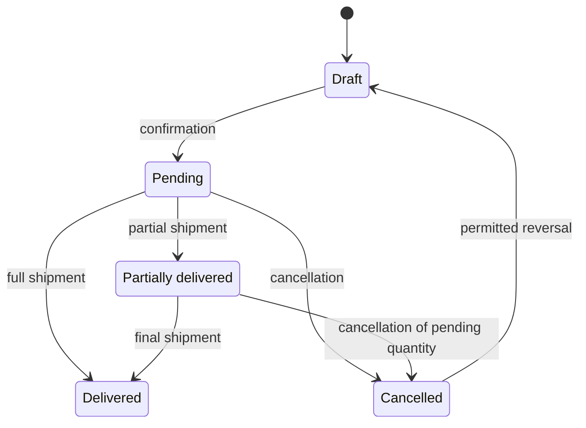

A **sales order** represents a commitment with a customer. Its lines generate demand only when confirmed.

The header identifies the customer, order code, dates, notes and external references. Lines indicate which item is needed, in what quantity, with which target date and delivery status.

## Header and lines

| Part | Contents | Purpose |
| --- | --- | --- |
| Header | Customer, code, name, order date, notes and external reference. | Groups the commercial commitment and connects it to integrations. |
| Line | Item, quantity, dates, fulfillment mode, status and delivered or pending quantities. | Generates demand and lets you track each delivery. |

An order can have several lines. Use separate lines when the item, quantity, expected date or fulfillment mode differ.

## What a sales order line is

A line is the unit planning can cover. The order's existence is not enough: demand originates in the line when you confirm it.

| Field | Use |
| --- | --- |
| Item | Exact variant the customer needs. |
| Requested quantity | Total quantity committed to the customer. |
| Shipped quantity | Part already dispatched through shipments. |
| Cancelled quantity | Part removed from the commitment. |
| Pending quantity | Quantity that still generates demand. |
| Requested date | Date requested by the customer. |
| Committed date | Date you commit to meeting, if provided. |
| Target date | Date planning uses to cover the line. |
| Fulfillment mode | Indicates whether the line is covered **Make to order** or **Make to stock**. |
| Availability | Shows whether current stock or planned supply covers the line. |

## Line lifecycle

| Status | Effect on planning | Meaning |
| --- | --- | --- |
| **Unconfirmed draft** | Does not generate demand. | You can adjust the item, quantity and fulfillment mode before committing the line. |
| **Pending** | Generates demand for the pending quantity. | The line is confirmed and has not been delivered. |
| **Partially delivered** | Generates demand only for the pending part. | One or more shipments have occurred, but a quantity remains to be delivered. |
| **Delivered** | Does not generate pending demand. | The open quantity has been dispatched. |
| **Cancelled** | Does not generate demand. | The open quantity is removed from the commitment. |

The order's status is derived from the statuses of its lines.

## Manufacture a line to order

On a **Pending** or **Partially delivered** line, use **Make to order** to cover it with your own manufacturing even if the item is configured to stock or you canceled its request. This action allows you to switch to **Make to order** after confirming the line, as an exception to editing the mode in draft:

- The line switches to **Make to order**, and shared stock and supply no longer cover its demand.
- If the item is manufactured, Bold creates a manufacturing request for the pending quantity, linked to the order and its customer.
- If the line already has an active request, no additional request is created. The button is disabled in that case.

On draft lines, change the fulfillment mode to **Make to order** in the line itself. The request is created when you confirm it.

The diagram summarizes the main transitions. Partial deliveries and cancellations retain quantities already shipped as history.

## Events that change a line

| Event | Effect on the model |
| --- | --- |
| Confirmation | The line changes from draft to pending and starts generating demand. |
| Date change | The target date is recalculated and updates planning's time reference. |
| Shipment | Increases the shipped quantity and reduces pending demand. |
| Cancellation of pending quantity | Removes the open quantity from the commitment. |
| Reversal of a cancellation | Returns the line to draft when the rules allow it. |

## Model rules

- Confirming a line requires an active item and is only possible from draft.
- You can edit the item, quantity and fulfillment mode only while the line is in draft. **Make to order** lets you switch a **Pending** or **Partially delivered** line to **Make to order**.
- Dates and notes can change after confirmation to keep planning updated.
- You cannot delete or cancel a delivered or partially delivered line as though it had never existed.
- If you cancel a pending quantity after a partial delivery, Bold retains the shipped part as history.
- The target date uses the committed date if provided. Otherwise, it uses the requested date or the order date plus the item's lead time.

<Info>
  The sales order explains the customer commitment. The shipment explains the physical outflow that reduces stock.
</Info>

## Relationship with planning and the warehouse

A confirmed line increases outgoing stock by its pending quantity. When the warehouse records a shipment, Bold reduces that pending demand and updates the line's status.

Line availability is calculated separately from delivery status. A line can be pending and still have planned supply.

<Note>
  Do not confuse delivery status with availability. The former indicates what part has already shipped; the latter indicates whether stock or future supply covers what remains pending.
</Note>

### Example of the two readings

A line requests 50 units, and 20 have already shipped. A confirmed purchase that will arrive on time covers the remaining 30.

| Reading | Result | Reason |
| --- | --- | --- |
| Delivery status | **Partially delivered** | 20 of 50 units have already shipped. |
| Pending demand | **30 units** | The part that has not yet shipped or been canceled. |
| Availability | **Planned** | Future supply covers the 30 pending units. |

Planned supply does not change delivery status. The line remains partially delivered until a shipment reduces the pending quantity.

## Permissions

| Action | Required permission |
| --- | --- |
| View sales orders | Read access to sales. |
| Create, edit, confirm or cancel sales orders | Edit access to sales. |

## Related

- [Customers](/en/concepts/planning/customers)
- [Demand and supply](/en/concepts/planning/demand-and-supply)
- [Shipments](/en/concepts/warehouse/shipments)
- [Create a sales order](/en/guides/sales/introduction)
- [Prepare and record a shipment](/en/guides/sales/prepare-and-record-a-shipment)
