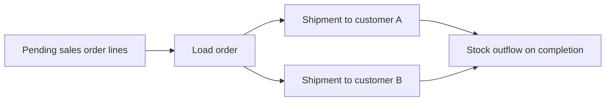
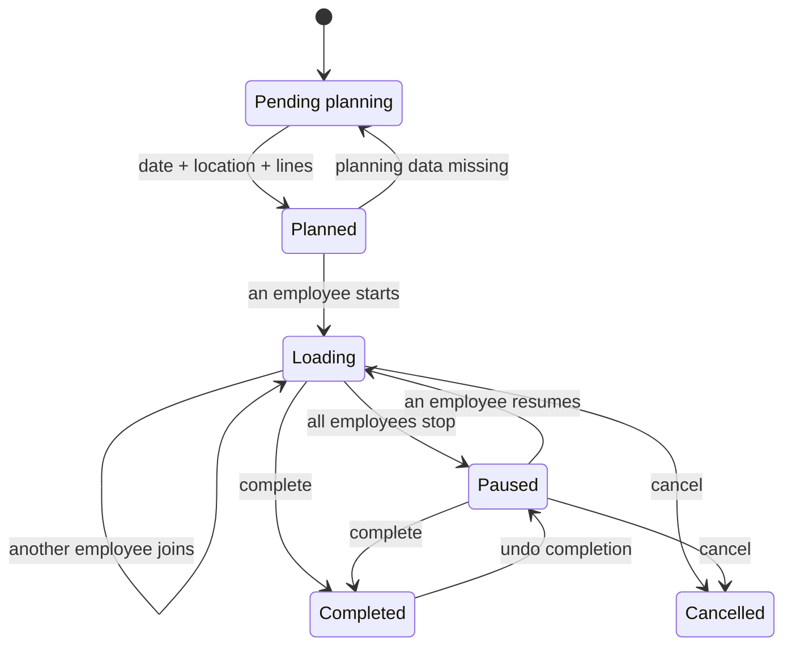

A **load order** groups the goods you will load onto a transport. It defines which lines must leave, when they are prepared and from which location.

The load order coordinates work. [Shipments](/en/concepts/warehouse/shipments) remain the documents that record the physical outflow to each destination.

## Elements of a load order

| Element | Use |
| --- | --- |
| Transport | Logistics resource assigned to the load. |
| Planned date and time | Expected time to prepare or load the goods. |
| Loading location | Warehouse location where material must be ready. |
| Lines | Pending quantities from sales order lines. |
| Shipments | Outflow documents grouped in the load. |
| Validation | Optional check of items, quantities and lots before completion. |
| Time records | Periods during which each employee works on the load. |

Transport is required when creating the order. You can fill in the date, location and name during planning. If you leave the name empty, Bold generates one from the transport and, where applicable, the date, customer, order or item.

## Relationship with orders and shipments

You can add entire orders or specific lines. Bold offers only lines with a quantity still available to load.

When you add an order line, Bold creates or reuses a shipment for the same customer within the load order. A load can contain several shipments when it carries goods for more than one destination.

## Order statuses

| Status | Meaning | Usual actions |
| --- | --- | --- |
| **Pending planning** | Date, loading location or at least one line is missing. | Edit, add or remove lines and delete. |
| **Planned** | Has a date, loading location and lines. | Request materials, edit, add or remove lines, delete or start. |
| **Loading** | One or more employees are working on the load. | Validate, complete, cancel or add another employee. |
| **Paused** | No active time records remain. | Resume, complete or cancel. |
| **Completed** | Shipments have been dispatched, and the stock outflow is recorded. | View or undo completion. |
| **Cancelled** | The started load was closed without completion. | View history. |

The order changes automatically between **Pending planning** and **Planned** when you fill in or remove the date, location or lines.

<Info>
  After starting the load, you cannot change the transport, date, location or validation rule. You can change the name while the order is loading or paused.
</Info>

## Material requests

A material request indicates whether Bold should prepare stock at the loading location.

| Status | Meaning |
| --- | --- |
| **Not requested** | Provisioning has not started yet. |
| **Requested** | Bold can now reserve stock and create movements to cover what is missing. |

When you request materials, Bold acts in this order:

1. Reserves stock already available at the loading location.
2. Calculates the missing quantity per line.
3. Creates [picking movements](/en/concepts/warehouse/warehouse-movements) to transfer the uncovered quantity.

If automatic provisioning is enabled, Bold requests materials for planned orders when they enter the configured lead time in working days.

## Provisioning statuses

The overall status shows the least advanced line. The **Lines** tab also shows each item's status, **Ready** quantity and **Incoming** quantity.

| Status | Meaning |
| --- | --- |
| **Provisioning not requested** | The order has not yet requested materials. |
| **Provisioning pending** | Requested, but there is no reserved stock or planned movement covering it. |
| **Provisioning in progress** | Some stock is ready or on the way, but a quantity remains uncovered. |
| **Provisioning planned** | Everything is ready or covered by movements awaiting execution. |
| **Stock ready** | All material is available at the loading location. |
| **No provisioning required** | The order has no pending material to prepare. |

**Ready** is the quantity already available and reserved at the loading location. **Incoming** is the quantity covered by ready or in-progress movements.

## Load validation

Validation records which quantity has been checked for each shipment and item. It can include the lot and package.

| Status | Meaning |
| --- | --- |
| **Not validated** | No quantity has been validated. |
| **Partially validated** | Part of the required quantity has been validated. |
| **Fully validated** | All lines have their full quantity validated. |

If the order requires validation, an employee must be working on the load to validate. Bold does not allow validating more than the required quantity.

When completing a load with incomplete validation, you can exclude unvalidated quantities. Bold also reduces or removes those lines in the shipments. You cannot exclude everything if it would leave the order empty.

## Completion, cancellation and reversal

When you complete the order, Bold:

- ends active time records;
- dispatches all shipments in the load;
- reduces stock at the loading location;
- retains items, lots, quantities and employees for traceability.

You can complete from **Loading** or **Paused**. You can cancel in those same statuses. To remove an order that has not started yet, delete it while it is pending planning or planned.

Undoing completion reverses associated shipments and returns the order to **Paused**. Reversal is possible only if the shipments still match the load lines and can be reversed.

## Related

- [Plan a load](/en/guides/warehouse/plan-and-prepare-a-load)
- [Load and close a dispatch](/en/guides/warehouse/execute-and-close-a-load-order)
- [Warehouse movements](/en/concepts/warehouse/warehouse-movements)
- [Shipments](/en/concepts/warehouse/shipments)
