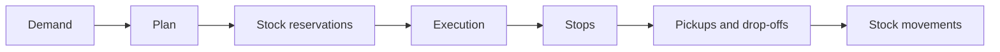
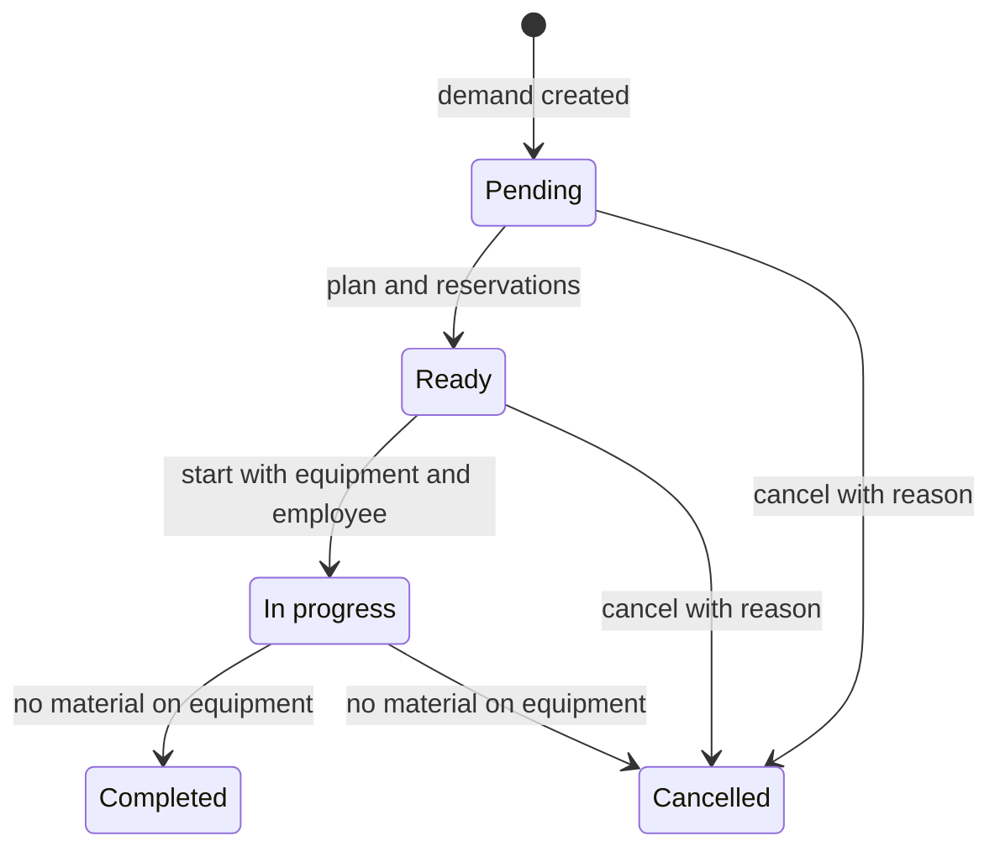

A **warehouse movement** is a task to pick up material at one or more locations and leave it at a destination.

It is different from a [stock movement](/en/concepts/warehouse/stock-and-movements). A warehouse movement directs physical work. Stock movements are the records that audit each pickup and drop-off.

## Movement types

| Type | When it is created | Destination |
| --- | --- | --- |
| **Picking** | A load order requests material that is not ready. | Loading location. |
| **Provisioning** | A manufacturing operation requests inputs that are not at the station. | The station's consumption location. |
| **Storing** | An employee creates a free movement in work mode. | Location chosen during execution. |

**Picking** and **Provisioning** movements originate from demand. Bold calculates what to pick up, from which location and in what order. A **Storing** movement starts without demand or a plan: the employee chooses the source, material and destination.

## Movement model

| Part | Contents |
| --- | --- |
| Demand | Destination, items or packages, quantities and source document. |
| Plan | Ordered stops and pickup or drop-off actions. |
| Reservations | Stock set aside so another task cannot allocate it first. |
| Execution | Equipment, employee, start and finish time. |
| Stops | Arrivals and departures at each location. |
| Actions | Item, lot, package, quantity and time of each pickup or drop-off. |

## How Bold plans

Bold deducts existing reservations before choosing stock. If demand does not specify a lot, it can select an available one. If demand specifies a lot, it must respect that choice.

The plan groups pickups by location. It orders source locations first and leaves the destination until last. Each action remains reserved until it is executed, canceled or no longer needed.

If stock covers only part of the demand, Bold prepares a movement for that part and leaves the rest in another pending movement. You can move what is available without losing the remaining requirement.

## Statuses and lifecycle

| Status | Meaning |
| --- | --- |
| **Pending** | Demand exists, but there is no executable plan yet for all or part of the material. |
| **Ready** | It has a plan and reservations, or is a free movement ready to start. |
| **In progress** | An employee is executing it with warehouse equipment. |
| **Completed** | All picked-up material has been dropped off and the task closed. |
| **Cancelled** | It was canceled with a reason and its reservations released. If in progress, its execution is also closed. |

You cannot complete or cancel a movement while the equipment still carries stock or packages. You can cancel a pending, ready or in-progress movement when no material remains in transit; the interface requests a cancellation reason.

## Planning issues

A pending movement can show an issue:

| Issue | Meaning | What to review |
| --- | --- | --- |
| **Insufficient stock** | There is not enough free quantity to create the plan. | Physical stock, location, lot and reservations. |
| **Requested container unavailable** | The package does not exist, is reserved or is unavailable. | Package location and status. |
| **The container content does not match** | The package does not contain the requested item, lot or quantity. | Recorded package contents. |
| **Reservation conflict** | Another process reserved the resource during planning. | Reservations and simultaneous movements. |

Bold retries planning pending movements when the corresponding stock increases or a reservation is released. **Due date** places the nearest requirements first.

## Execution and stock in transit

When started, the movement is assigned to one [piece of warehouse equipment](/en/concepts/warehouse/warehouse-equipment-and-transports). Equipment cannot execute two movements at once.

Each pickup transfers stock to the equipment's internal location. **Current load** shows the loose stock and packages it carries. Each drop-off moves those contents from the equipment to the destination location.

For loose stock, execution preserves the item, lot and quantity. For a package, it moves the package and all its recorded contents as a unit.

## Demand and reservations at the destination

Before creating a movement, Bold reserves stock already at the destination. The movement covers only the remaining quantity.

When material arrives, the reservation transfers to the line that generated demand:

- a manufacturing operation input;
- a load order line.

If required quantities change before starting, Bold can cancel movements that have not been executed, release reservations and calculate new ones.

## Related

- [Provision raw materials](/en/guides/warehouse/provision-raw-materials)
- [Plan and prepare a load](/en/guides/warehouse/plan-and-prepare-a-load)
- [Move stock](/en/guides/warehouse/move-stock-between-locations)
- [Warehouse equipment and transports](/en/concepts/warehouse/warehouse-equipment-and-transports)
- [Stock and movements](/en/concepts/warehouse/stock-and-movements)
