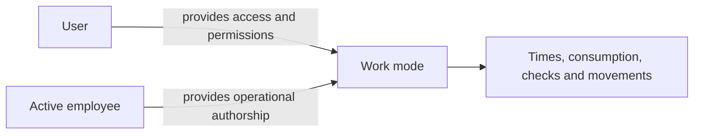

**Work mode** is the daily interface for executing shop floor tasks. It is designed for operators recording work, stock, times, checks or interventions through a more direct workflow than the administrative application.

## What changes from the regular application

| Regular application | Work mode |
| --- | --- |
| Configures data, reviews lists and manages processes. | Executes assigned or available tasks. |
| Uses user permissions. | Associates activity with an operational employee. |
| Prioritizes analysis and full editing. | Prioritizes scanning, quick selection and shop floor recording. |
| Can show many company areas. | Shows production, warehouse and maintenance workflows. |

The user controls access. The employee identifies who performs operational work. Read [Employees](/en/concepts/people/employees) for the difference between user and employee.

## Available areas

| Area | Main use |
| --- | --- |
| Production | View your operations, start, pause, resume, record progress, consume materials and complete checks. |
| Warehouse | Execute movements, stock counts, receipts and load orders, and view stock or packages. |
| Maintenance | Execute work orders and record times, actions or materials. |

Work mode does not replace configuration. Use the regular application to create recipes, locations, assets, shifts or permissions.

## Active employee

The **active employee** is the operational identity Bold associates with actions, times, tasks and records.

This affects:

- execution traceability;
- labor records;
- operation assignments;
- actual costs;
- operational audit trail.

<Tip>
  One employee identity per person preserves authorship of each action and avoids mixing times or costs.
</Tip>

## What work each employee sees

In production, **My operations** organizes the active employee's tasks. The company configures one of two sources: **Skills** or **Usual workstations**. It does not combine both criteria at once.

| Criterion | How it affects the work list |
| --- | --- |
| Skills | Shows operations whose process matches an employee skill. |
| Usual workstations | Shows operations planned at the employee's usual workstations. |

The **By workstation**, **By area**, **By process** and **Search** tabs are alternative ways to find work outside **My operations**. [Skills and usual stations](/en/concepts/people/skills-and-usual-workstations) help filter the list but do not replace an actual assignment.

## Production records

Production presents operations and groups as work units. Their records describe progress, consumption, production, checks, times and interruptions according to the order's configuration.

While you prepare an operation's production record, Bold automatically saves a draft without a save button. The draft includes completed and rejected quantities, consumption with its lots and co-products:

- There is one draft per operation, shared by all employees and devices. Saved changes are recovered when you return to the operation. If you try to reload or close with pending changes, the browser warns you; cancel leaving and wait for saving to finish.
- If there is no connection, Bold indicates this and retries saving the draft.
- If several operators work on the same record, each device receives the others' changes within a few seconds. Lines changed on another device are highlighted with the employee's name. A field you are editing is not overwritten; if two people change the same line, the last saved change takes precedence.
- The draft is discarded when progress is recorded through any route: work mode, Control panel, API or Boldy. Other devices detect this and show updated pending quantities.
- If you separate an operation from a group and Bold records the group's excess production in it, it also discards its draft. If separation does not record progress, it preserves the draft.
- It is also discarded when the operation finishes or is canceled and deleted when you delete the operation. If completion fails, the draft is preserved.
- If you reopen an operation or undo a record, pending saves and confirmations from before that change are rejected. Reopen the record to prepare current quantities.

Read [Checks, consumption and pauses](/en/concepts/manufacturing/checks-consumption-and-pauses) for theoretical quantity calculations and lot selection.

A [pause reason](/en/concepts/manufacturing/pause-reasons-and-interruptions) classifies each interruption. The pause retains duration and context so dashboards distinguish execution from stopped time.

## Warehouse entities

The warehouse area separates five operational entries:

| Entry | Use |
| --- | --- |
| **Movements** | Pick up and drop off material between locations with warehouse equipment. |
| **Stock counts** | Count stock by location and record readings. |
| **Receipts** | Review and complete supplier or customer inflows. |
| **Load orders** | Prepare, validate and complete planned loads. |
| **Stock** | View items, lots, locations and packages. |

A [warehouse movement](/en/concepts/warehouse/warehouse-movements) directs the physical transfer. A [load order](/en/concepts/warehouse/load-orders-and-provisioning) coordinates goods to prepare and dispatch.

## Scanning and quick selection

Work mode can use QR codes or barcodes to find employees, operations, packages, items, lots, locations or documents.

Use labels and codes when the workflow depends on identifying physical objects without searching lists. Read [Designs and labels](/en/concepts/control-panel/designs-and-labels) for printing.

## Relationship with other concepts

| Concept | Relationship |
| --- | --- |
| Operations | Production work executed in work mode. |
| Operation groups | Let you execute several operations together when they share operational context. |
| Skills and usual stations | Help show relevant tasks for the active employee. |
| Inspections and checks | Can block starting, progress or closing until the result is recorded. |
| Pause reasons | Explain interruptions during operations or groups. |
| Work orders | Executed from maintenance and feed history and costs. |

## Related

- [Execute operations on the shop floor](/en/guides/manufacturing/execute-shop-floor-operations)
- [Skills and usual stations](/en/concepts/people/skills-and-usual-workstations)
- [Assignments and operation groups](/en/concepts/manufacturing/assignments-and-operation-groups)
- [Inspections and checks](/en/concepts/manufacturing/inspections-and-checks)
- [Pause reasons and interruptions](/en/concepts/manufacturing/pause-reasons-and-interruptions)
- [Warehouse movements](/en/concepts/warehouse/warehouse-movements)
- [Load orders](/en/concepts/warehouse/load-orders-and-provisioning)
