This section walks through the minimum workflow to start using Bold: prepare master data, define how you manufacture a familiar product, create an order, turn it into a manufacturing order, and record its execution.

Start with a small case. Use a familiar product, a short recipe, an operational employee, and a production resource. Then expand your catalog, permissions, locations, and inspections.

## Operational workflow

<Steps>
  <Step title="Prepare the catalog and warehouse">
    Create the family, finished item, and components you want to consume. Add a location if you will record consumption or production with stock. Decide whether you need lot traceability.
  </Step>
  <Step title="Record demand">
    Create a sales order with the manufactured item. Confirm the line so Bold includes it in planning.
  </Step>
  <Step title="Plan supply">
    Review what you need to purchase and manufacture. Recommendations are not commitments until you create purchase orders, requests, or manufacturing orders.
  </Step>
  <Step title="Execute purchasing or manufacturing">
    Receive the necessary purchases, launch the MO, and record operations, consumption, and production.
  </Step>
  <Step title="Deliver to the customer">
    When stock is available, prepare the shipment and record dispatch to complete the cycle.
  </Step>
</Steps>

## First guided test

<Steps>
  <Step title="Prepare master data">
    Create the catalog, at least one operational employee, and the minimum production resources. Use a product the team recognizes.
  </Step>
  <Step title="Configure the recipe">
    Define a simple version with one main operation, the necessary inputs, and the finished item output. Activate the version.
  </Step>
  <Step title="Create and confirm the order">
    Record a sales order with the manufactured item. Confirm the line to generate demand.
  </Step>
  <Step title="Launch the MO">
    Review the manufacturing need, create a request where applicable, and generate the MO using the active recipe.
  </Step>
  <Step title="Execute on the shop floor">
    Open **work mode**, select the employee, start the operation, record progress and consumption, and finish the MO.
  </Step>
</Steps>

## How it connects

```mermaid
flowchart LR
  catalogo["Catalog<br/>product, item, and components"] --> personas["Employee<br/>operational recording"]
  personas --> recursos["Resource<br/>compatible workstation"]
  recursos --> receta["Active recipe<br/>operations and inputs"]
  receta --> pedido["Sales order<br/>confirmed line"]
  pedido --> demanda["Demand<br/>quantity and date"]
  demanda --> peticion["Manufacturing request<br/>what is missing"]
  peticion --> of["MO<br/>how it is manufactured"]
  of --> ejecucion["Work mode<br/>execution and traceability"]
  ejecucion --> stock["Produced stock<br/>finished item"]
  stock -. optional .-> envio["Shipment<br/>dispatch to the customer"]
```

The order describes demand. The manufacturing request describes what remains to be manufactured. The MO describes how the work will run on the shop floor.

<Warning>
  A draft order line does not generate demand. Confirm the line when you want planning and manufacturing to include it.
</Warning>

## What you should validate

| Area | Expected result |
| --- | --- |
| Catalog | The family and finished item are used in the order, recipe, and MO. |
| People | The employee appears in **work mode** and is associated with operational records. |
| Resources | The operation can run at a compatible workstation or resource. |
| Recipe | The active version copies operations, inputs, and outputs to the MO. |
| Order | The confirmed line generates demand for the manufactured item. |
| Manufacturing | The MO records progress, consumption, production, and closing. |

## Complete the walkthrough

<Columns cols={2}>
  <Card title="Prepare master data" icon="database" href="/en/guides/getting-started/prepare-master-data">
    Create the minimum catalog, employees, and resources for the first case.
  </Card>

  <Card title="Define a manufacturing process" icon="book-open" href="/en/guides/getting-started/define-a-manufacturing-process">
    Prepare a short recipe for the product you will manufacture.
  </Card>

  <Card title="Create an order and launch an MO" icon="clipboard-list" href="/en/guides/getting-started/create-an-order-and-launch-an-mo">
    Turn confirmed demand into a manufacturing order.
  </Card>

  <Card title="Execute your first MO" icon="play" href="/en/guides/getting-started/execute-your-first-mo">
    Record execution, consumption, and production from the shop floor.
  </Card>

  <Card title="Prepare and record a shipment" icon="truck" href="/en/guides/sales/prepare-and-record-a-shipment">
    Dispatch the order when you also want to validate stock leaving the warehouse.
  </Card>

  <Card title="Understand Bold" icon="book-open" href="/en/concepts/overview">
    Consult concepts when you need to understand a term before continuing.
  </Card>
</Columns>

## What to leave for later

You do not need to configure the entire factory before validating the workflow. Add these elements once the first walkthrough works.

| Element | When to add it |
| --- | --- |
| Complete catalog | When the team has validated how to model products and items. |
| Detailed permission profiles | When you know which actions each responsibility needs. |
| Lots, packages, and containers | When you need physical traceability or logistics preparation. |
| Complex quality inspections | When the minimum recipe already generates executable operations. |
| Costs and dashboards | When execution data is stable. |

## Related

- [Demand and supply](/en/concepts/planning/demand-and-supply)
- [Manufacturing requests](/en/concepts/manufacturing/manufacturing-requests)
